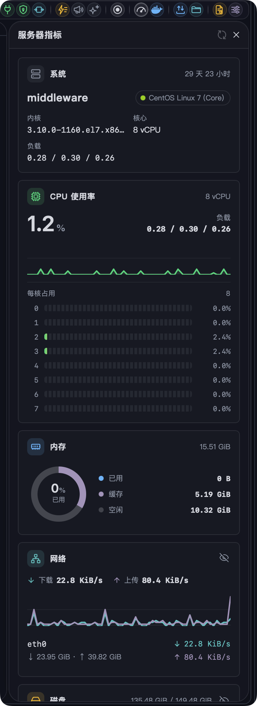
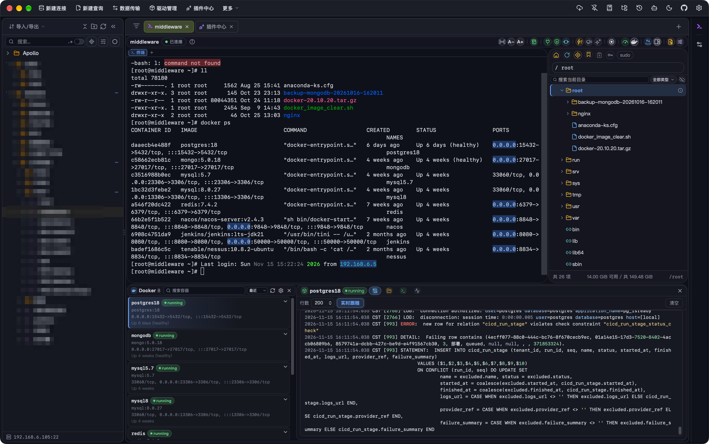
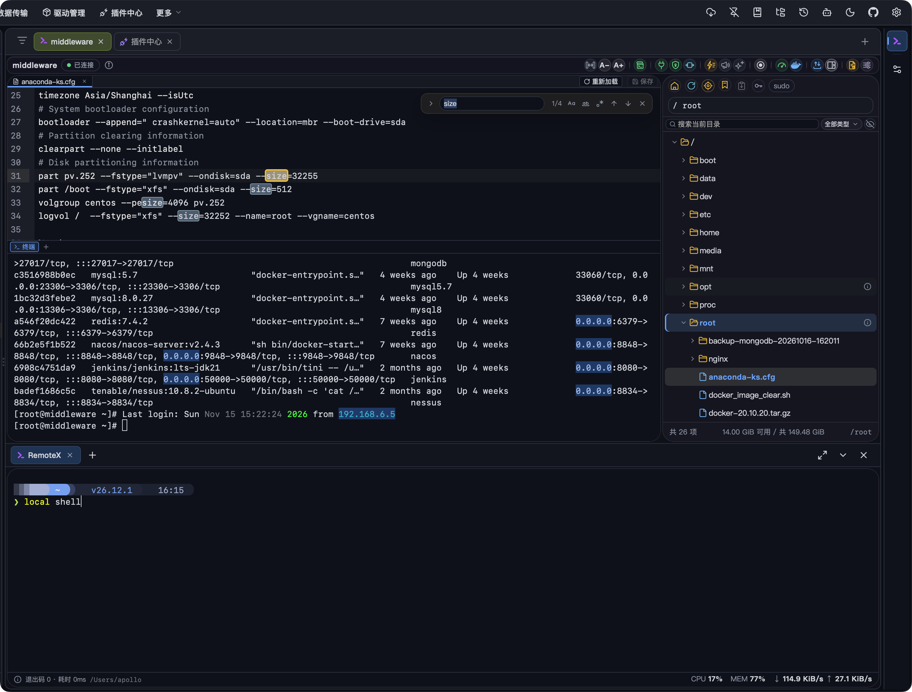
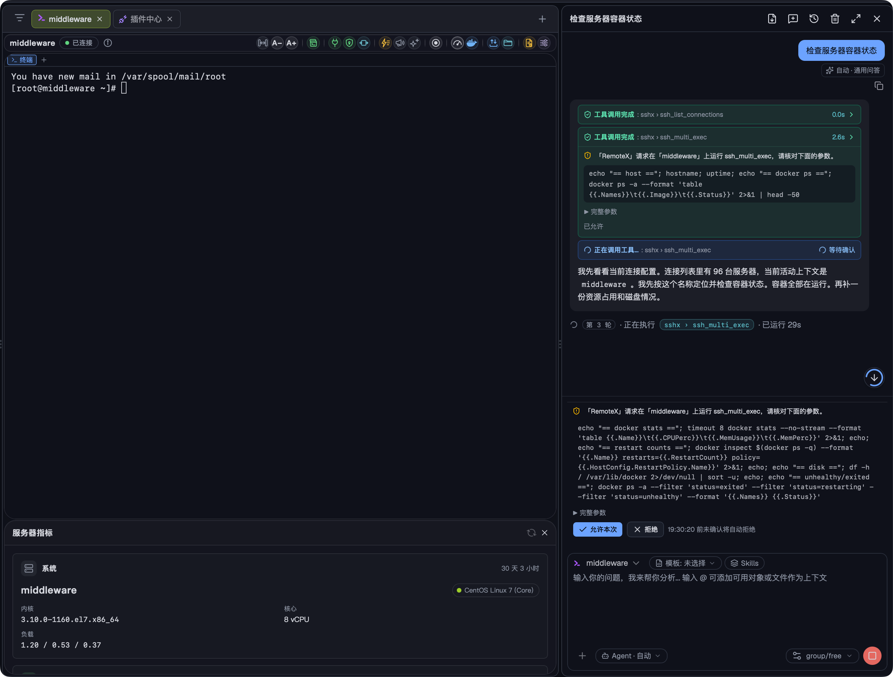
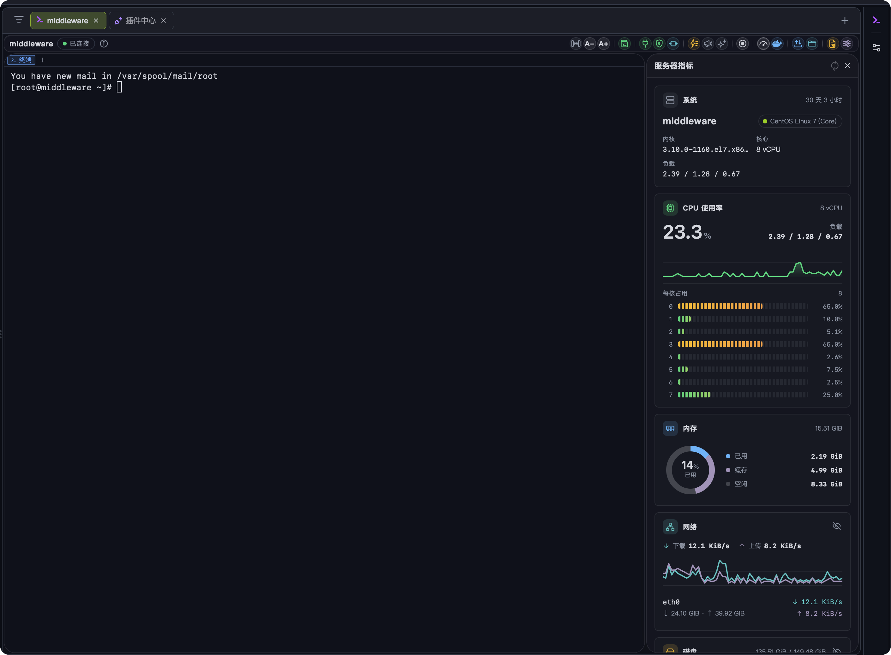

# RemoteX

[中文](README.md) · [Documentation index](docs/README.md)

RemoteX is a remote-connection workbench for DBX. One connection entry covers SSH,
Telnet, VNC, RDP, serial, and local shell sessions, and keeps the terminal, SFTP,
port forwarding, containers, metrics, recording, and MCP automation in one workspace.
It is built for the hour after login, not just the moment of connecting: fewer
window switches, fewer copied credentials, guarded high-risk actions, and a record
of what happened.



## What it does

| Job | How RemoteX helps |
| --- | --- |
| Inspect and troubleshoot | PTY terminal, command history, quick commands, output highlighting, directory tracking, cancellable execution |
| Manage files | SFTP browse, preview, edit, drag-and-drop upload, resume, batch delete, archive/extract, bookmarks |
| Reach private networks | Up to three ProxyJump hops, keepalive, Known Hosts verification |
| Forward ports | Local, remote, and SOCKS5 dynamic forwarding in one Port forwards workbench |
| Operate containers | Container list, logs, resource stats, container terminal, and file browser |
| Watch server state | CPU, memory, network, disk, and process views with a compact summary in the terminal corner |
| Guard risky work | Read-only mode, command allowlists, sudo profiles, destructive-command confirmation, audit and alerts |
| Review what happened | Terminal recording, replay, GIF and transcript export, per-connection transfer history |
| Automate with AI | 16 MCP tools that reuse saved connections without putting passwords in tool arguments |

## Protocols

| Protocol | Capabilities |
| --- | --- |
| SSH | Password, private key, key + passphrase, SSH Agent, keyboard-interactive, Auto; TOTP/2FA; ProxyJump; PTY; SFTP; port forwarding |
| Telnet | Interactive terminal, resize, replay, automatic login |
| Serial | Port enumeration, interactive terminal, file upload, replay |
| VNC | Remote framebuffer, keyboard and pointer input, clipboard |
| RDP | Password/NLA, TLS, clipboard, reconnect; no audio or drive redirection |
| RemoteX | Local login shell with the same tabs, recording, and notification experience |

When creating a connection, choose the **RemoteX** entry and then select the protocol
inside the form. Host, port, credentials, and protocol-specific fields follow that choice.

## Common workflows

**From login to diagnosis**

1. Open a connection; the terminal establishes a PTY.
2. Run inspection commands through quick commands or batch input; highlight rules mark errors and keywords.
3. Open the server metrics overlay to inspect CPU, memory, network, and processes.
4. Switch to SFTP, preview or edit a file, then save with atomic replacement.

**Move files safely**

- Drag files into the SFTP pane or paste local files from the clipboard.
- Large transfers show progress and can be cancelled; interrupted transfers can resume.
- Deletion lists the files and folders first; multi-select deletion runs as a batch plan.
- Transfer history is scoped to each connection, so connections never share rows.

**Elevate with guardrails**

- Connection-level read-only mode constrains SFTP writes, command execution, and MCP tools.
- Sudo profiles can pin a command allowlist and credential source.
- Destructive commands require explicit confirmation; the audit page keeps execution records and alerts.

**Record and review**

- Recordings are asciicast v2 `.cast` files stored on this machine.
- The recordings panel provides a timeline, search, replay, GIF, and transcript export.
- Only terminal output and input are recorded. System pointer positions, cursor coordinates, and clipboard contents are not captured.

## Install

Download the `.dbxp` for your platform and architecture from
[GitHub Releases](https://github.com/apolloqi123/dbx-plugin-remotex/releases), then use
“Install from local file” in the DBX plugin center. Refresh or restart the plugin to
see the **RemoteX** connection entry and workbench.

Requirements:

- DBX host `host_api >= 1.0.0`
- macOS, Linux, or Windows, matching the architecture of the release package

## Build from source

```bash
# Frontend
pnpm --dir frontend install
pnpm --dir frontend typecheck
pnpm --dir frontend test
pnpm --dir frontend build

# Backend
cargo test --manifest-path backend/Cargo.toml
cargo build --release --manifest-path backend/Cargo.toml

# Package a .dbxp (requires the dbx-plugin CLI)
scripts/build.sh
```

Artifacts are written to `dist/`. See the [development guide](docs/development.zh-CN.md)
for the full build and verification flow.

## Security boundaries

- Passwords, private-key passphrases, TOTP seeds, and sudo credentials are managed by DBX host secret bindings.
- One-time 2FA codes entered at connect time are used for that authentication only; they are not persisted or logged.
- Known Hosts verification is on by default. A changed host key is rejected with an explicit message.
- MCP tools pass read-only checks, path checks, command allowlists, and destructive-command confirmation before execution.
- Recording files, transfer history, and logs may contain sensitive data; treat them as local sensitive data.

See the [security model](docs/security.zh-CN.md) for details.

## Documentation

| Document | Contents |
| --- | --- |
| [Documentation index](docs/README.md) | All documents and a suggested reading order |
| [Getting started](docs/getting-started.zh-CN.md) | Install, first connection, interface tour |
| [Feature guide](docs/features.zh-CN.md) | Terminal, SFTP, forwarding, containers, recording, automation |
| [Architecture](docs/architecture.zh-CN.md) | Processes, modules, data flow, packaging |
| [RPC protocol](docs/architecture/PROTOCOL.zh-CN.md) | Method catalog, events, binary channels, error codes |
| [Security model](docs/security.zh-CN.md) | Credentials, host verification, read-only boundaries, audit |
| [MCP quick start](docs/guides/MCP_USAGE.en.md) | Two connection modes and common tools |
| [MCP reference](docs/guides/MCP.zh-CN.md) | Tool semantics, permission profiles, errors, long-running tasks |
| [Development guide](docs/development.zh-CN.md) | Environment, tests, packaging, release checks |
| [Troubleshooting](docs/troubleshooting.zh-CN.md) | Connection, transfer, terminal, and build issues |

## Screenshots

| Server metrics | Docker workbench |
| --- | --- |
|  |  |

| Terminal with live metrics | AI terminal and tool approval |
| --- | --- |
|  |  |

## License

[MIT](LICENSE)
