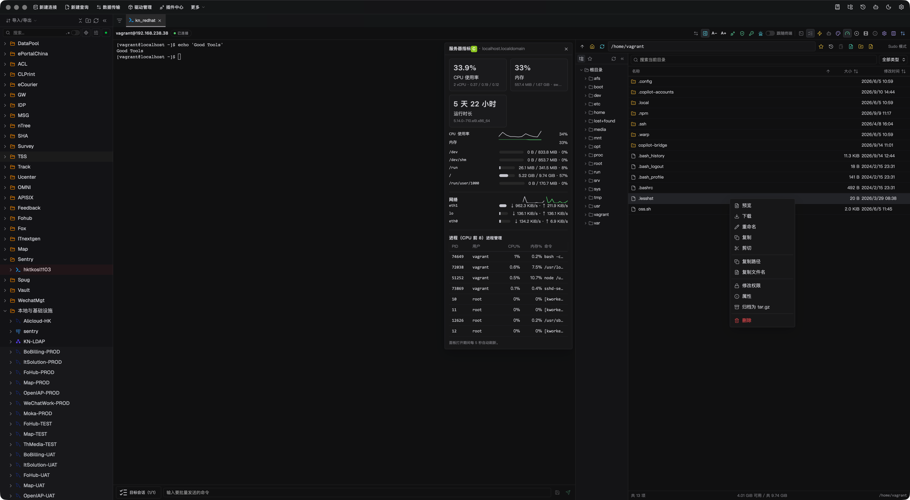

# RemoteX

[](https://github.com/jinpy666/dbx-plugin-sshx/actions/workflows/ci.yml)
[](https://github.com/jinpy666/dbx-plugin-sshx/releases)

[中文](README.md) · [Showcase](docs/guides/MEDIA.en.md) · [Feature comparison](docs/architecture/COMPARISON.en.md) · [Repository split notes](docs/architecture/REPOSITORY_SPLIT.en.md)

RemoteX is a remote-connection workspace for modern operations teams. One entry
reaches SSH, Telnet, VNC, RDP, serial and local shell sessions, then moves into file
transfer, jump-host access, guarded elevation, and MCP automation without losing
context. It turns the next hour after “logging into a server” into one coherent,
reusable, auditable workflow.

> RemoteX · SFTP · Remote Operations: one DBX workspace for interactive terminals, files, automation, and guarded server operations.

## See it in action

[Watch the 87-second live workflow demo (click to play)](docs/media/dbx-ssh-live-demo.mp4) ·
[Watch the 15-second feature preview](docs/media/dbx-ssh-demo.mp4)



If your workflow jumps between a terminal, a separate SFTP client, jump-host config files,
and one-off automation scripts, RemoteX gives you a simpler center of gravity:
connections, terminal, files, and automation share the same DBX connection context.

## Why teams reach for it

| Your job | The RemoteX workflow |
| --- | --- |
| Resolve an incident quickly | PTY terminal, command history, quick commands, cancellable commands, and directory tracking |
| Move files safely | SFTP preview, drag and drop, progress, cancellation, acknowledgements, and atomic replacement |
| Reach private servers | Up to three ProxyJump hops, keepalive, and Known Hosts verification |
| Put guardrails around risk | Read-only mode, selectable sudo source, command allowlists, and host secret bindings |
| Automate repeatable work | MCP tools that reuse connections, approvals, and permission boundaries |

## Use cases

- Inspect Linux and Unix servers, review logs, and run remote commands.
- Reach private environments through jump hosts while keeping terminal and SFTP in one workspace.
- Upload and download configuration files, scripts, and build artifacts under controlled permissions.

## Highlights

- Password, private-key, SSH Agent, keyboard-interactive, and passwordless authentication.
- Interactive PTY terminal with resize, session recovery, clipboard support,
  remote-directory tracking, and batch input.
- **Duplicate session** opens an independent terminal over the current authenticated SSH transport without asking for MFA again; **New session** still creates and authenticates a fresh transport.
- SFTP browsing, sorting, preview, upload, download, rename, create, drag and drop,
  and recursive delete. Focus the SFTP pane and press Ctrl/Cmd+V to upload local
  files from the system clipboard into the current directory.
- Large-file transfers with progress, cancellation, acknowledgements, and atomic replacement.
- Known Hosts verification, changed-key rejection, read-only mode, and directory disk usage.
- ProxyJump chains up to three hops, keepalive, cancellable remote commands, chmod,
  and Quick Sudo.
- TOTP and keyboard-interactive two-factor authentication. Rotating app, hardware-token,
  or SMS codes can be entered in a masked connection-time dialog instead of being saved.
  MCP tools are also available for automation clients.
- Simplified Chinese, Traditional Chinese, English, Spanish, Italian, Japanese,
  and Portuguese UI.

Clipboard file paste uses the native `paste` file event exposed by the host/browser. If a host
does not expose that event, the Upload button and drag-and-drop workflow remain available.

See the [feature and competitor comparison](docs/architecture/COMPARISON.en.md) for a capability matrix
covering OpenSSH + sftp, Tabby, Termius, FinalShell, electerm, and iSHell Pro.

> **Protocol roadmap:** the DBX plugin picker now exposes a single **RemoteX** entry. Choose
> SSH, Telnet, VNC, RDP (experimental), serial, or local shell inside the connection form;
> host, port, credentials and protocol-specific fields follow the selected type. More
> remote-access scenarios are on the way — check the release notes for each version.

More screenshots live in the [showcase page](docs/guides/MEDIA.en.md).

## MCP automation

The plugin ships 16 MCP tools — remote commands, sudo elevation, SFTP file transfer,
terminal input, and connection management — so AI coding agents (ZCode, Claude, or any MCP
client) can operate your servers inside your permission boundaries. Two ways to connect:

**Option 1: the DBX MCP bridge (recommended).** DBX's MCP server ships two generic
bridge tools, `dbx_list_plugin_tools` and `dbx_call_plugin_tool`, that discover and call
every installed plugin's MCP tools. Pass a `connectionId` to reference a saved SSH
connection: credentials are resolved host-side and never appear in tool arguments, while
approvals, sudo allowlists, and read-only mode keep working.

**Option 2: standalone stdio mode.** Register the plugin binary directly as an MCP
server — no DBX required:

```json
{
  "mcp": {
    "servers": {
      "sshx": {
        "type": "stdio",
        "command": "/absolute/path/dbx-plugin-sshx",
        "args": ["--mcp"]
      }
    }
  }
}
```

For production hosts, expose a read-only MCP entry point (the whole process is forced
through the read-only gate; tools cannot turn it off):

```bash
DBX_SSH_MCP_READ_ONLY=1 dbx-plugin-sshx --mcp
```

| Job | Tools |
| --- | --- |
| Remote inspection | `ssh_exec`, `ssh_multi_exec`, `sftp_list_dir`, `sftp_stat` |
| Privileged work | `ssh_exec_sudo` (auto-answers TOTP), Quick Sudo profiles |
| Long-running jobs | `ssh_run_bg` + `ssh_task_status` (survive disconnects and new sessions) |
| File transfer | `sftp_upload` / `sftp_download` / `sftp_read_file` / `sftp_write_file` |
| Session management | `ssh_terminal_input`, `ssh_list_connections`, `ssh_close`, `ssh_list_known_hosts` / `ssh_remove_known_host` |

For full configuration, credential-free connection addressing, the tool catalog, and the
safety model, see the [MCP guide](docs/guides/MCP_USAGE.en.md) and the
[SSH MCP reference](docs/guides/MCP.zh-CN.md).

## Security

Passwords, private-key passphrases, TOTP secrets, and sudo credentials are managed
through DBX host secret bindings. A manually entered login token is used only for that
authentication attempt and is not persisted or logged. The plugin does not write credentials
to config files, logs, or exports. For production connections, enable strict Known Hosts
verification and use read-only mode or a sudo command allowlist when appropriate.

## Installation

Download the platform-specific `.dbxp` package from
[GitHub Releases](https://github.com/jinpy666/dbx-plugin-sshx/releases), then install it from
the DBX plugin center. Developers can build a candidate package using the
[repository split and release notes](docs/architecture/REPOSITORY_SPLIT.en.md).

## Development

```bash
pnpm --dir frontend install
pnpm --dir frontend typecheck && pnpm --dir frontend test && pnpm --dir frontend build
cargo test --manifest-path backend/Cargo.toml
python3 scripts/verify/validate_repo.py && node scripts/verify/connection-forms/verify.mjs
scripts/test.sh --skip-host
```

Protocol, packaging, and integration details live under `docs/`. Contributors
should read the [repository split notes](docs/architecture/REPOSITORY_SPLIT.en.md) first.
