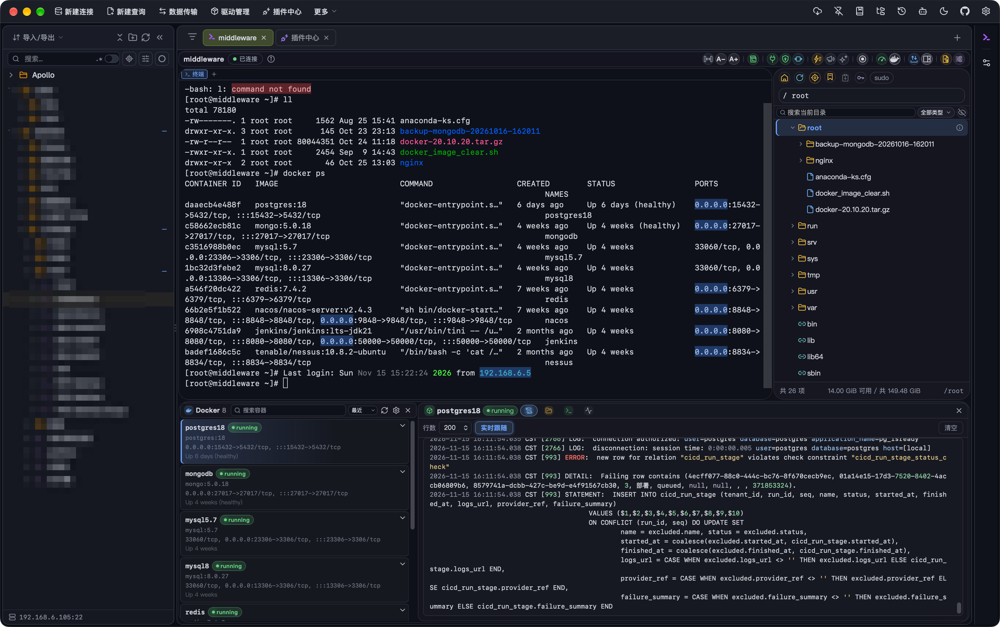
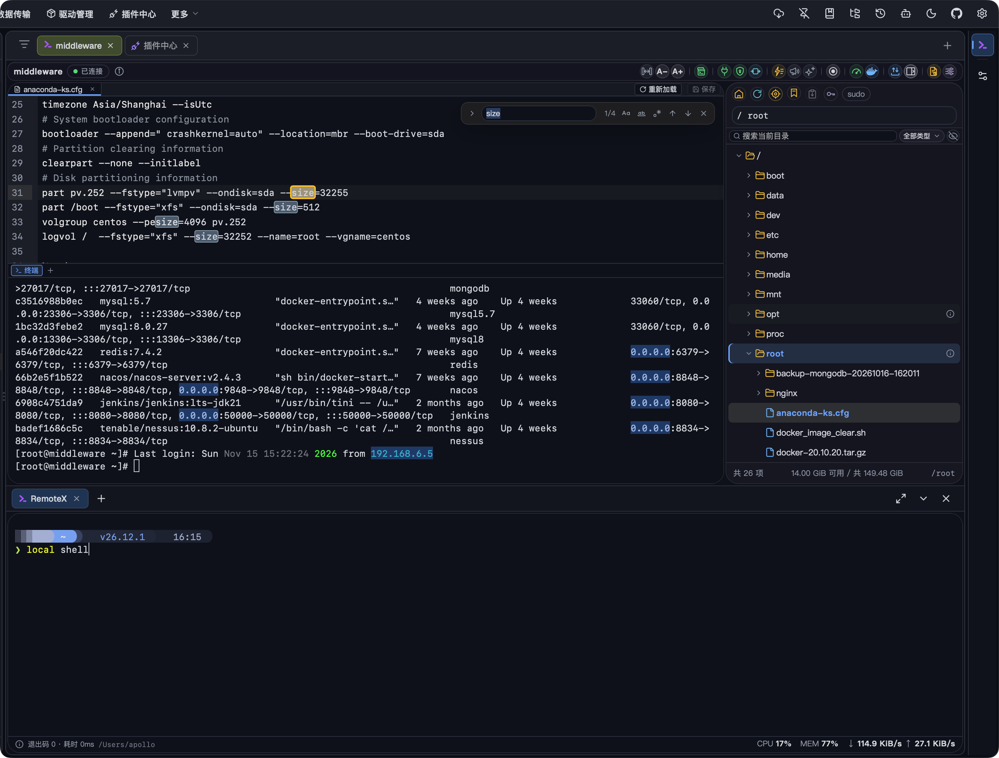
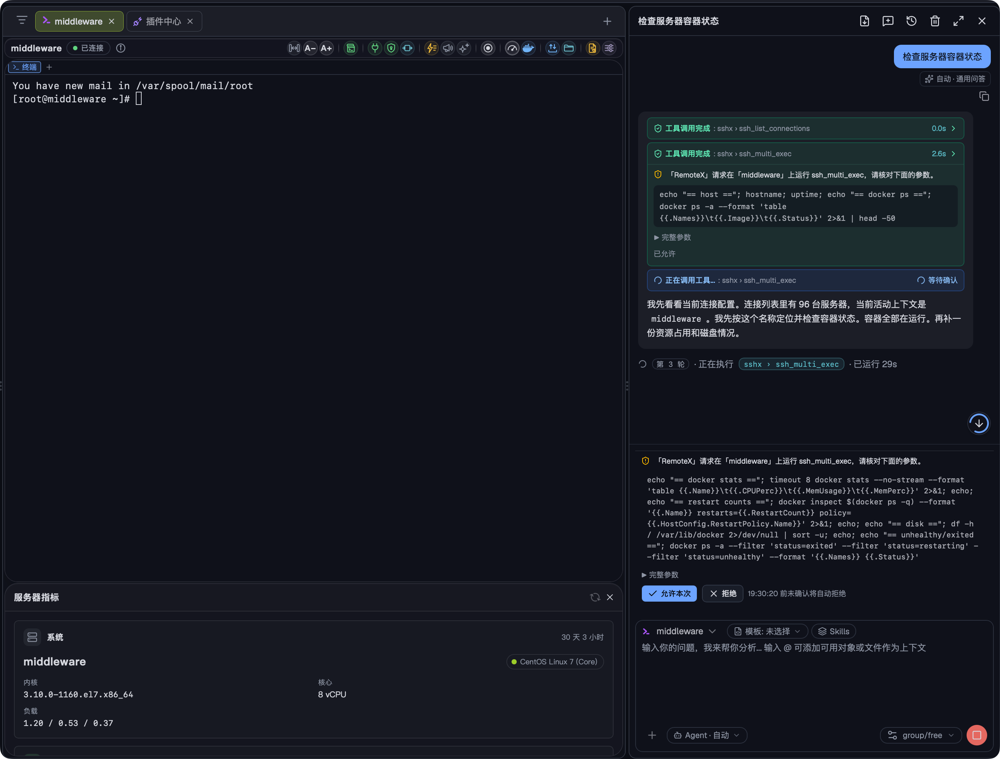
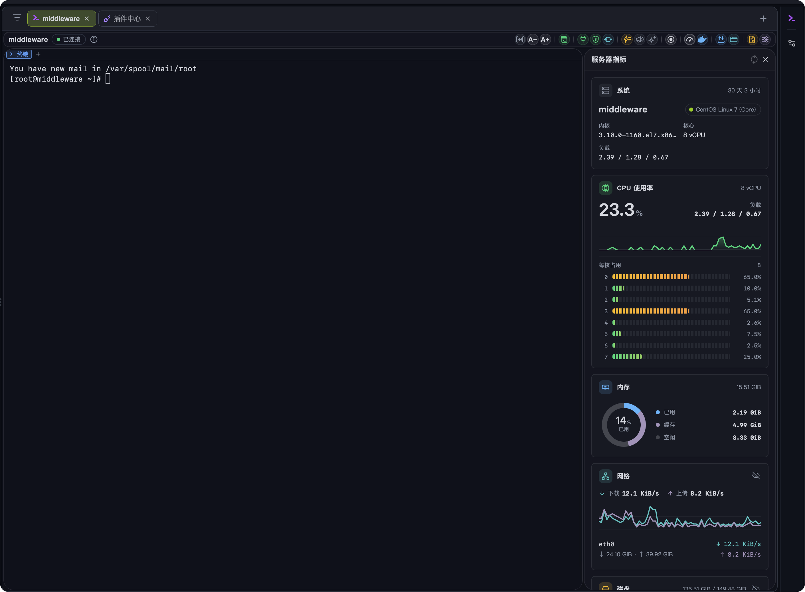

# RemoteX

[English](README.en.md) · [文档索引](docs/README.md)

RemoteX 是 DBX 的远程连接工作台。覆盖 SSH、Telnet、VNC、RDP、串口与本机
终端，并把终端、SFTP、端口转发、容器、监控、录制和 MCP 自动化放在同一个工作区里。
它关心的不是“连上去”这一秒，而是登录之后的整个操作过程：少切窗口、少复制凭据、
危险操作有边界、做过的事能回看。

## 能做什么


| 场景      | RemoteX 的做法                                |
| ------- | ------------------------------------------ |
| 日常巡检与排障 | PTY 终端、命令历史、快速命令、输出高亮、目录跟随、可取消执行           |
| 文件管理    | SFTP 浏览、预览、编辑、拖放上传、断点续传、批量删除、压缩/解压、书签      |
| 进入内网    | 最多三跳 ProxyJump、连接保活、Known Hosts 校验         |
| 端口转发    | 本地、远程与 SOCKS5 动态转发，统一在 Port forwards 工作台管理 |
| 容器运维    | 容器列表、日志、资源统计、容器终端与文件浏览                     |
| 状态观察    | CPU、内存、网络、磁盘与进程视图，终端右下角常驻摘要                |
| 受控操作    | 只读模式、命令白名单、sudo 档案、危险命令确认、审计与告警            |
| 留痕与复盘   | 终端录制、回放、GIF 与转录文本导出，按连接隔离的传输历史             |
| AI 自动化  | 16 个 MCP 工具，复用已保存连接，不把密码放进工具参数             |


## 支持的协议


| 协议      | 能力                                                               |
| ------- | ---------------------------------------------------------------- |
| SSH     | 密码、私钥、私钥+口令、SSH Agent、键盘交互、Auto；TOTP/2FA；ProxyJump；PTY；SFTP；端口转发 |
| Telnet  | 交互式终端、窗口调整、回放、自动登录                                               |
| 串口      | 端口枚举、交互终端、文件上传、回放                                                |
| VNC     | 远程画面、键鼠输入、剪贴板                                                    |
| RDP     | 密码/NLA、TLS、剪贴板、断线重连；不含音频与磁盘重定向                                   |
| RemoteX | 本机登录 Shell，与远程终端一致的标签页、录制与通知体验                                   |


新建连接时只需选择 **RemoteX** 入口，再在表单里选择协议；主机、端口、凭据和协议专属
字段会随选择切换。

## 几个常用工作流

**从登录到定位问题**

1. 打开连接，终端自动建立 PTY。
2. 用快速命令或批量输入执行巡检命令，输出按高亮规则标出错误与关键字。
3. 打开服务器指标浮层查看 CPU、内存、网络与进程。
4. 需要改配置时切到 SFTP，双击文件预览或编辑，保存后原子替换。

**安全地传文件**

- 拖放或粘贴本地文件到 SFTP 面板即可上传。
- 大文件显示进度并可取消；中断后可继续。
- 删除前列出待删文件/文件夹；多选删除按计划批量执行。
- 传输历史按连接隔离，切换连接不会看到别的连接的记录。

**受控提权**

- 连接级只读模式会同时约束 SFTP 写操作、命令执行与 MCP 工具。
- sudo 档案可预设命令白名单与凭据来源。
- 命中危险命令时要求显式确认；审计页可回看执行记录与告警。

**录制与复盘**

- 录制文件为 asciicast v2 `.cast`，保存在本机。
- 录制面板提供时间线、搜索、回放、GIF 与转录导出。
- 只记录终端输出与输入，不采集系统鼠标指针、光标坐标或剪贴板内容。

## 安装

从 [GitHub Releases](https://github.com/apolloqi123/dbx-plugin-remotex/releases) 下载匹配平台与
架构的 `.dbxp`，在 DBX 插件中心选择“从本地安装”。安装后重启或刷新插件即可看到
**RemoteX** 连接入口与工作台。

要求：

- DBX 宿主 `host_api >= 1.0.0`
- macOS、Linux 或 Windows（按发布包架构选择）

## 从源码构建

```bash
# 前端
pnpm --dir frontend install
pnpm --dir frontend typecheck
pnpm --dir frontend test
pnpm --dir frontend build

# 后端
cargo test --manifest-path backend/Cargo.toml
cargo build --release --manifest-path backend/Cargo.toml

# 打包 .dbxp（需要 dbx-plugin CLI）
scripts/build.sh
```

产物在 `dist/`。构建与验证的完整说明见 [开发指南](docs/development.zh-CN.md)。

## 安全边界

- 连接密码、私钥与私钥口令由 DBX 宿主的 secret binding 管理；Quick Sudo 与 OTP 种子由插件 vault 以字段级 AEAD 加密后落盘。
- 连接时临时输入的双因素验证码只用于本次认证，不持久化、不写日志。
- Known Hosts 默认校验；主机密钥变化时拒绝连接并给出明确提示。
- MCP 工具在执行前经过只读检查、路径检查、命令白名单与危险命令确认。
- 录制文件、传输历史与日志都可能包含敏感信息，请按本机敏感数据管理。

更多细节见 [安全模型](docs/security.zh-CN.md)。

## 文档


| 文档                                            | 内容                   |
| --------------------------------------------- | -------------------- |
| [文档索引](docs/README.md)                        | 全部文档与阅读顺序            |
| [快速开始](docs/getting-started.zh-CN.md)         | 安装、建立第一条连接、界面导览      |
| [功能指南](docs/features.zh-CN.md)                | 终端、SFTP、转发、容器、录制、自动化 |
| [架构说明](docs/architecture.zh-CN.md)            | 进程、模块、数据流与打包结构       |
| [RPC 协议](docs/architecture/PROTOCOL.zh-CN.md) | 方法总表、事件、二进制通道与错误码    |
| [安全模型](docs/security.zh-CN.md)                | 凭据、主机校验、只读边界与审计      |
| [MCP 快速开始](docs/guides/MCP_USAGE.zh-CN.md)    | 两种接入方式与常用工具          |
| [MCP 参考](docs/guides/MCP.zh-CN.md)            | 工具语义、权限档、错误与长任务      |
| [开发指南](docs/development.zh-CN.md)             | 环境、测试、打包与发布检查        |
| [故障排查](docs/troubleshooting.zh-CN.md)         | 连接、传输、终端、构建的常见问题     |


## 截图

| 服务器指标 | Docker 工作台 |
| --- | --- |
|  |  |

| 终端与实时指标 | AI 终端与工具审批 |
| --- | --- |
|  |  |


## 许可

[MIT](LICENSE)