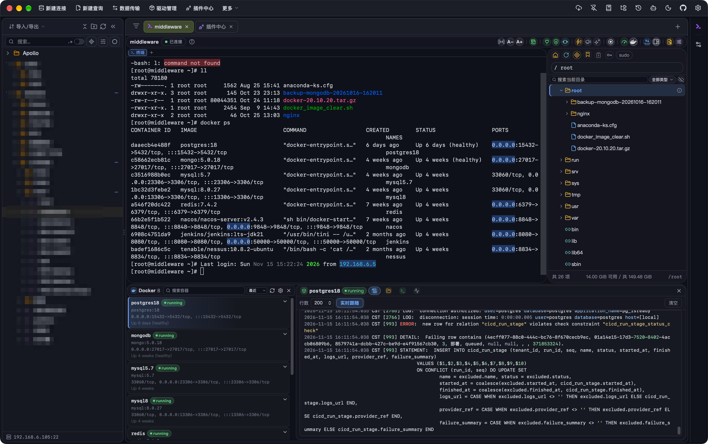
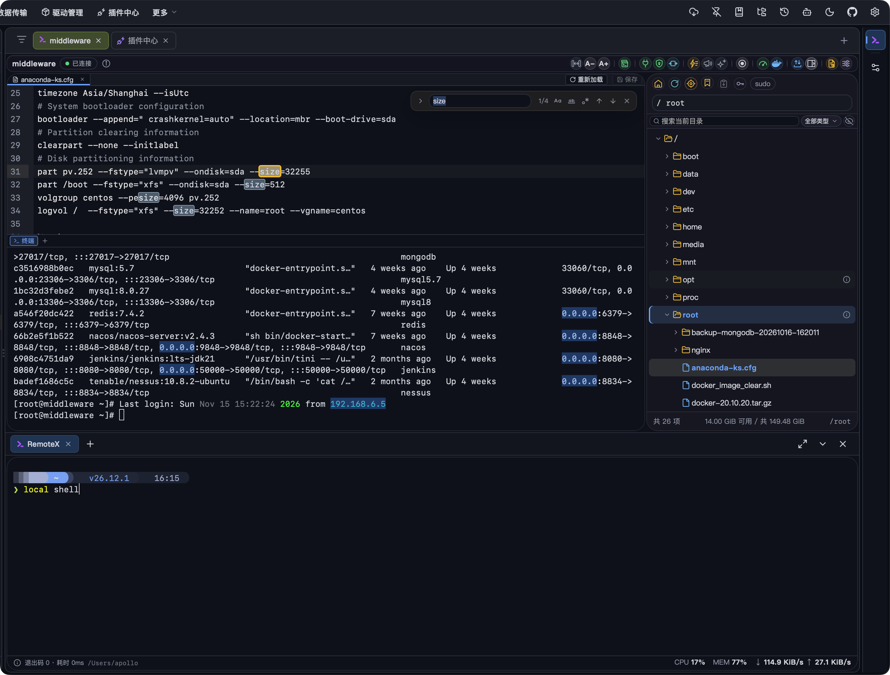

# 功能指南

本文按工作台区域说明 RemoteX 的能力与交互。安装与第一条连接见
[快速开始](getting-started.zh-CN.md)。

## 连接

### 一个入口，六种协议

新建连接时选择 **RemoteX**，再在表单内选择协议：

| 协议 | 默认端口 | 主要字段 |
| --- | --- | --- |
| SSH | 22 | 主机、用户名、认证方式、私钥/密码、跳板链 |
| Telnet | 23 | 主机、用户名、密码、自动登录 |
| VNC | 5900 | 主机、密码（经典 8 字节以内） |
| RDP | 3389 | 主机、用户名、密码、证书策略 |
| Serial | — | 串口设备、波特率等线路参数 |
| RemoteX | — | 本机登录 Shell |

切换协议时，不相关的字段会隐藏，保留的字段随协议复用。

### SSH 认证

- **Password**：密码来自表单或本地命令。
- **Private key**：支持 OpenSSH、PEM、PPK。可填路径，也可直接粘贴内容；内容优先于路径。
- **Private key, then password**：先私钥，未通过时再输入密码。
- **SSH Agent**：使用环境中的 `SSH_AUTH_SOCK`，或 Windows Pageant；可单独指定 socket。
- **Auto**：依次尝试密码、私钥、键盘交互与 Agent，直到一种成功。
- **No authentication**：服务器允许无认证登录时使用。

密码来源：

- **Enter in this form**：保存在 DBX 宿主 secret store。
- **Local command**：连接时执行本地命令，stdout 去掉末尾一个换行作为密码。命令以
  当前用户权限运行，适合从密码管理器取值。

### 跳板与保活

- ProxyJump 最多三跳，每一跳可独立配置主机、端口、用户名与认证。
- 连接保活会定期发送 keepalive；长时间无输出不会误判断线。
- 断开后标签页显示状态；可重连，已认证传输上的“复制会话”不受影响。

### Known Hosts

- 首次连接未知主机时显示指纹并请求确认。
- 确认后写入插件自己的 known_hosts 文件，不修改系统 `~/.ssh/known_hosts`。
- 主机密钥变化时拒绝连接；可在 Known Hosts 设置中查看指纹并移除旧记录。
- MCP 独立 stdio 模式对未知主机使用 TOFU（首次信任），记录后变化仍拒绝。

### 双因素与 OTP

- 支持 TOTP 与键盘交互式挑战。
- 连接时弹出的验证码只用于当次认证。
- OTP 管理页支持手动添加、二维码导入、生成当前验证码、删除。
- MCP 的 `ssh_exec_sudo` 可在 sudo 阶段自动应答 TOTP。

## 终端

### 标签、分屏与复制会话

- 一个连接可打开多个终端标签。
- 支持上下/左右分屏，每个分屏独立 PTY。
- **复制会话**：在已认证的 SSH transport 上开新 PTY，不重新认证，适合堡垒机动态令牌场景。
- **新建会话**：建立全新连接并重新认证。
- 标签会显示连接状态；断线后保留回放内容。

### 输出与输入

- xterm.js 渲染，支持 WebGL、Unicode 11、图片、链接与搜索。
- 终端输出按序号分帧传输。前端发现序号缺口时主动请求回放补齐，洪峰后不会停在旧画面。
- 输入带序号确认；写入失败会触发错误事件，标签不会假装仍在线。
- 支持复制模式、滚动回看、搜索高亮、清屏、字体缩放。

### 快速命令

- 保存常用命令，按分组管理。
- 可从侧栏一键发送到当前会话，或发送到所有会话。
- 支持变量占位与确认提示。

### 输出高亮

- 自定义规则：正则、颜色、是否整行高亮。
- 内置常见错误、警告、成功模式。
- 规则按连接或全局保存。

### 批量输入

- 打开批量输入条，把同一段输入发送到多个已选会话。
- 可选是否包含本地终端。
- 每个会话独立确认输入序号，失败会在该会话上报错。

### 命令执行与取消

- 非交互命令通过 `ssh/exec` 执行，返回 stdout/stderr/退出码。
- 长命令可取消；取消会终止远端进程并返回已收集输出。
- 目录跟随解析提示符与 OSC 7，SFTP 面板可跟随终端当前目录。

## SFTP 与远程文件

### 浏览

- 双栏或树形浏览；支持排序、过滤、显示隐藏文件。
- 显示权限、大小、修改时间、所有者与符号链接目标。
- 支持书签、主目录跳转、路径直接输入。
- 显示远程磁盘用量。

### 预览与编辑

- 文本、图片、二进制摘要预览。
- 内置编辑器基于 CodeMirror，支持语法高亮与主题同步。
- 保存时先写临时文件，再原子替换目标，降低半成品风险。
- 可用本机外部编辑器打开；保存后自动同步回远端。

### 上传与下载

- 拖放上传；聚焦 SFTP 面板后按 `Ctrl/Cmd+V` 可上传剪贴板中的本地文件。
- 文件与目录均可传输；目录下载可打包为单流传输。
- 显示进度、速度、剩余时间；可取消。
- 断点续传：中断后重新发起会提示续传位置。
- 可设置并发传输数与下载限速。
- 支持 gzip 压缩通道；远端缺少工具时自动回退普通传输。

### 文件操作

- 新建文件/文件夹、重命名、移动、复制、删除、chmod、touch。
- 创建、读取、修改符号链接。
- 压缩为归档、解压归档。
- 批量删除：
  - 删除前列出待删文件与文件夹。
  - 多选删除生成删除计划，按批执行，减少逐项往返。
  - 进度与失败项在传输面板可见。

### 传输历史

- 每个连接独立一份传输历史，切换连接不会混入其他连接的记录。
- 全局保留最近 200 条终态记录；当前会话的内存视图保留最近 64 条。
- 可按连接清空；清空只影响当前连接。
- 历史记录包含方向、文件名、大小、状态、时间与错误；不包含凭据或文件内容。

## 端口转发

Port forwards 工作台统一管理三种转发：

| 类型 | 用途 |
| --- | --- |
| Local | 把本地端口转发到远端可达的地址 |
| Remote | 把远端端口转发回本地可达的地址 |
| Dynamic | 本地 SOCKS5 代理，按目标动态建连 |

- 转发可绑定到某条已保存连接，连接打开时自动启动。
- 列出监听地址、端口、目标与状态。
- 支持启动、停止、查看错误。
- 转发状态变化会通知前端，异常退出可见。

## 远程桌面

### VNC

- 远程帧缓冲、键鼠输入、剪贴板同步。
- 窗口尺寸变化时请求服务器调整。
- 断线重连与会话状态事件。
- 画面通过二进制通道 `vnc/frame/<sessionId>` 传输。

### RDP

- 密码/NLA、TLS。
- 剪贴板文本同步。
- 断线重连。
- 文件剪贴板通过分块通道传输，支持开始、分块、提交、读取与清理。
- 不含音频、磁盘重定向与键盘抓取。

远程桌面画面不写入终端录制；录制只覆盖终端会话。

## 串口

- 枚举本机串口设备。
- 配置波特率、数据位、停止位、校验、流控。
- 交互式终端，支持窗口调整与回放。
- 文件上传使用独立分块通道；上传期间拒绝普通输入，避免协议交错。
- 适合网络设备、嵌入式板卡与串口控制台。

## 服务器指标

- 系统信息：主机名、发行版、内核、运行时长、核心数、负载。
- CPU：总使用率、每核占用、历史曲线。
- 内存：已用、缓存、空闲与占用环。
- 网络：上下行速率、累计流量、每网卡明细。
- 磁盘：容量、已用、挂载点。
- 进程：CPU/内存排序、结束进程。
- 终端右下角常驻 CPU、内存与网络摘要，不占用标签栏。

指标通过远端 `/proc`、`df` 等只读命令采集；采集失败会在面板中显示原因。

## Docker

- 容器列表：名称、镜像、状态、端口、运行时长。
- 容器操作：启动、停止、重启、删除（受权限与确认约束）。
- 日志：实时跟随、暂停、清空、下载。
- 统计：CPU、内存、网络、块 I/O。
- 容器终端：独立 PTY，支持窗口调整。
- 容器文件：浏览、读取、上传、下载、导入导出、清理。
- 本地 Docker 与远程（经 SSH）Docker 使用同一套界面。

## 录制与回放

- 录制格式为 asciicast v2 `.cast`，保存在本机。
- 录制入口在工具栏；开始前有 3 秒倒计时，可取消。
- 录制记录面板：
  - 时间线视图，当前录制带实时标记。
  - 搜索录制内容并显示命中片段。
  - 刷新、停止、全部清空。
  - `Enter` 打开回放，`Esc` 关闭。
  - 导出 GIF 或转录文本。
  - 在文件夹中显示。
  - 删除单条记录。
- 回放按录制时间轴还原终端输出。
- 只记录终端输入与输出，不记录系统鼠标指针、光标坐标、剪贴板或凭据。

## 安全与审计

- 连接级只读模式。
- 命令白名单与危险命令确认。
- sudo 档案：凭据来源、命令白名单、是否允许交互。
- 审计：记录命令执行、提权、危险操作与拒绝原因。
- 告警：可对敏感命令、频繁失败、只读拒绝等事件触发提示。
- MCP 调用同样经过只读、路径与危险命令检查。

详见 [安全模型](security.zh-CN.md)。

## 自动化

- **定时任务**：按 cron 表达式执行命令或脚本。
- **触发器**：监听终端输出中的模式，匹配后执行动作。
- **多机执行**：一条命令在多个连接上执行并聚合结果。
- **常驻任务**：任务状态与输出可轮询，断线不丢。
- **终端触发器校验**：保存前校验正则与动作。

自动化任务通过宿主 Scheduler 或插件内任务提供者运行；失败会记录在任务状态中。

## 连接导入

支持 OpenSSH、Xshell、SecureCRT、Termius、MobaXterm、FinalShell、Electerm、
WindTerm。导入流程：

1. 选择来源与文件/目录。
2. 预览解析结果与冲突。
3. 确认导入。

导入只创建新连接；不修改来源文件。

## 界面与本地化

- 七种语言：简体中文、繁体中文、英语、西班牙语、意大利语、日语、葡萄牙语。
- 浅色/深色主题跟随宿主。
- 可设置终端字体、字号、行高、光标样式与壁纸。
- 快捷键可在设置中查看与修改。

## MCP 自动化

RemoteX 暴露 16 个 MCP 工具，覆盖远程执行、文件传输、连接查询与 known_hosts 管理。
两种接入方式：

1. **DBX MCP 桥**：复用 DBX 已保存连接，凭据不出现在工具参数中。
2. **独立 stdio 模式**：`dbx-plugin-sshx --mcp`，适合没有 DBX 宿主的客户端。

详见 [MCP 快速开始](guides/MCP_USAGE.zh-CN.md) 与 [MCP 参考](guides/MCP.zh-CN.md)。
